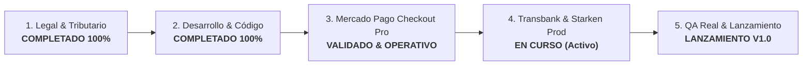
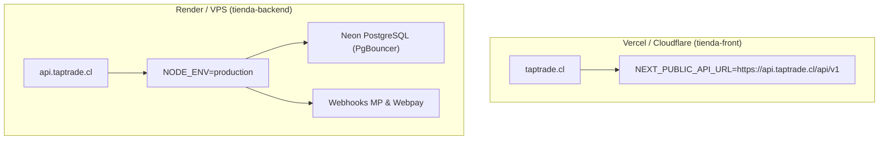

# 🚀 Plan Maestro de Puesta en Marcha y Lanzamiento (TapTrade SpA)

Este documento es la **hoja de ruta actualizada** para la puesta en marcha de **TapTrade** (V1.0), el marketplace chileno especializado en cartas coleccionables (TCG). Refleja con exactitud lo que ya está construido, lo que está en curso y los pasos críticos restantes para abrir las puertas al público.

---

## 📊 Estado General del Proyecto

---

## ✅ Fase 1: Constitución Legal y Tributaria (Completado)
*La empresa existe formalmente, tiene cuenta bancaria y autorización legal para operar y facturar en Chile.*

- [x] **1.1. Constitución SpA:** Constitución formal en *Tu Empresa en un Día* para **TapTrade SpA** (RUT: `78.531.106-K`).
- [x] **1.2. Domicilio Legal y Oficina Virtual:** Contrato de arriendo firmado en Providencia (Padre Mariano 98 Of. 315).
- [x] **1.3. Inicio de Actividades (SII):** 1ra Categoría, afecto a IVA (Giros: 479100 Venta online, 631200 Portales web, 620900 Servicios TI).
- [x] **1.4. Facturación Electrónica SII:** Certificado digital adquirido e inscripción autorizada en el sistema gratuito del SII para emitir facturas y guías.
- [x] **1.5. Cuenta Bancaria Empresa:** Cuenta bancaria a nombre de TapTrade SpA operativa para recaudación y liquidaciones.

---

## ✅ Fase 2: Plataforma, Código y Arquitectura (Completado)
*Todo el software base, modelo de base de datos e integraciones técnicas ya se encuentran programados y validados.*

- [x] **2.1. Arquitectura Multi-Vendor (Marketplace):**
  - Carrito consolidado que desglosa compras multi-tienda con órdenes secundarias independientes (`VendorOrder`).
  - Panel administrativo integral de compras, inventario y despachos para cada tienda.
  - Sistema de comisiones de plataforma (`Application Fee`) y billetera con retención anti-fraude.
- [x] **2.2. Módulo de Pagos Dual (Checkout Pro & Webpay Plus):**
  - **Mercado Pago Checkout Pro (Redirección Externa):** SDK oficial implementado con creación de preferencias (`Preference.create`), reserva atómica de inventario, cálculo de recargo de pasarela (3.79%), retorno automático (`back_urls`) y recepción de parámetros en `checkout/result`.
  - **Transbank Webpay Plus:** Provider inyectable con `transbank-sdk` oficial, preparado para alternar entre ambientes `integration` y `production`.
- [x] **2.3. Logística y Despacho Multi-Courier:**
  - **Chilexpress:** Conexión en tiempo real a la API oficial (`services.wschilexpress.com`). Consulta en vivo de hitos de entrega, validación de formato OT (10-12 dígitos) y protección anti-duplicados.
  - **Starken:** Conexión programada al servicio de tracking de `developers.starken.cl` (`resumenTrackingCargaRedestinacion`), mapeo cronológico de eventos de transporte y tarjeta de contingencia premium con barra de progreso de 3 etapas.
  - **Retiro en Tienda:** Flujo de entrega presencial en local con confirmación manual para liberación de fondos.
  - **Línea de Tiempo Interactiva:** Componente unificado `CarrierTimeline.tsx` disponible tanto para compradores en `my-account` como para vendedores en el panel de administración.
- [x] **2.4. Catálogo y Cubicaje Especializado TCG:**
  - Sincronización de cartas mediante API de JustTCG.
  - Calculador dinámico de bultos y fletes por peso y dimensiones para cartas individuales en toploaders, carpetas y cajas selladas.
- [x] **2.5. Correos Transaccionales y Notificaciones:**
  - Envío automático de confirmaciones de compra, notificaciones de despacho y alertas de cambio de estado vía SMTP / Resend.
- [x] **2.6. Arquitectura Multi-Branch (Empresas y Sucursales):**
  - Modelo relacional Company (Holding legal y Billetera centralizada) -> Store (Sucursales físicas independientes con inventario y retiro propio).
  - Selector de sucursal activa en el header superior de /admin (BranchSelector).
  - Directorio jerárquico en /superadmin/stores con desglose de Casa Matriz y Sucursales Extra (+2.5 UF/mes).
- [x] **2.7. Punto de Venta POS Mostrador & Arqueos de Caja:**
  - Apertura y cierre de turnos de caja (CashShift) por sucursal física con cálculo de efectivo esperado y arqueo multi-cajero.
  - Venta física con medios de pago múltiples (efectivo, débito, crédito, transferencia) y deducción atómica de inventario.

---

## ⚡ Fase 3: Credenciales de Producción y Homologación (Fase Actual)
*Configuración de llaves comerciales reales y habilitación de contratos bancarios.*

### A. Pasarelas de Pago
- [x] **3.1. Mercado Pago (Producción & Checkout Pro):**
  - [x] Aplicación configurada en Mercado Pago Developers (App ID: `7728076449389840`).
  - [x] Flujo de Checkout Pro (Redirección Externa segura) programado y validado de punta a punta.
  - [x] Validación de retorno y comprobante en TapTrade (`/checkout/result`) operativo.
  - [x] Variables de entorno `APP_USR-...` cargadas en Render para cobro real.
- [ ] **3.2. Transbank Webpay Plus (Papeleo & Homologación):**
  - [ ] Solicitar afiliación a Webpay Plus en [transbank.cl](https://publico.transbank.cl) con los antecedentes legales de TapTrade SpA para obtener Código de Comercio.
  - [ ] Homologación en [transbankdevelopers.cl](https://www.transbankdevelopers.cl) (verificación de Términos, Políticas, Carro en CLP y logos de tarjetas).
  - [ ] Generación de API Key Secreta de Producción y carga en variables de entorno de Render (`WEBPAY_ENV="production"`).

### B. Couriers y Logística
- [x] **3.3. Chilexpress API:** Credenciales y Subscription Key oficiales listas y cargadas en `.env`.
- [ ] **3.4. Starken API (Producción):**
  - Correo enviado a `asistenciaplugin@starken.cl` solicitando activación de credenciales de producción para la cuenta registrada de TapTrade SpA.
  - Al recibir respuesta, cargar en `.env` la clave y activar `STARKEN_ENV="production"`.

---

## ☁️ Fase 4: Despliegue en la Nube y Validación Técnica
*Infraestructura en la nube y dominios definitivos con SSL.*

- [x] **4.1. Despliegue Backend en Render:** Servicio NestJS desplegado y conectado a base de datos Neon PostgreSQL.
- [ ] **4.2. Dominios y SSL:**
  - Apuntar DNS de `taptrade.cl` y `www.taptrade.cl` a Vercel.
  - Apuntar DNS de `api.taptrade.cl` al servicio backend en Render.
  - Verificar certificados SSL (HTTPS obligatorio en ambos extremos para auto_return de Mercado Pago y Webpay).
- [ ] **4.3. Seguridad en Producción:**
  - Confirmar que `NODE_ENV=production` oculta la documentación Swagger y activa cookies de sesión seguras (`SameSite=None`, `Secure=true`).
  - Verificar que CORS solo admita peticiones desde `https://taptrade.cl`.

---

## 🧪 Fase 5: Pruebas Transaccionales Reales (Sanity Check End-to-End)
*Simulacro con compras reales de bajo monto antes de invitar a usuarios externos.*

- [x] **5.1. Test de Flujo Mercado Pago:** Flujo de pago, retorno y comprobante de orden validado exitosamente.
- [ ] **5.2. Test de Pago Real con Webpay Plus:**
  - Realizar una compra real de prueba con tarjeta de débito/crédito en `taptrade.cl` una vez aprobada la API Key de Transbank.
  - Confirmar que Transbank descuenta el dinero y redirige exitosamente a la pantalla de compra confirmada.
  - Verificar en base de datos que la orden cambió a `PAID` y se desglosaron las `VendorOrder`.
- [ ] **5.3. Test de Despacho y Tracking:**
  - Despachar la orden de prueba ingresando un número de seguimiento real de Chilexpress o Starken.
  - Revisar en el perfil del comprador (`/my-account?tab=orders`) que la línea de tiempo `CarrierTimeline` consulte y muestre los hitos en vivo.
- [ ] **5.4. Test de Retiro en Tienda:**
  - Simular una compra con retiro local presencial y verificar que no exige número de flete y permite confirmar entrega directamente.

---

## 🎯 Fase 6: Apertura y Salida al Mercado (Go-To-Market)
*Lanzamiento oficial de TapTrade V1.0.*

- [ ] **6.1. Onboarding de Tiendas Piloto:**
  - Invitar a las tiendas aliadas beta a crear su perfil oficial (nombre, logo, comuna de origen, métodos de despacho permitidos).
  - Cada tienda realiza la vinculación OAuth de su cuenta de Mercado Pago con un solo clic para recibir abonos directos.
  - Carga y verificación de stock de cartas y productos sellados.
- [ ] **6.2. Retiro de Pantallas de Mantenimiento:**
  - Habilitar el catálogo completo al público general en `https://taptrade.cl`.
- [ ] **6.3. Difusión y Lanzamiento:**
  - Anuncio en comunidades chilenas de TCG (Magic: The Gathering, Pokémon, Yu-Gi-Oh!, Mitos y Leyendas, One Piece).
  - Publicación en redes sociales oficiales de TapTrade.
  - Monitoreo de logs y métricas de servidor durante las primeras 48 horas.
