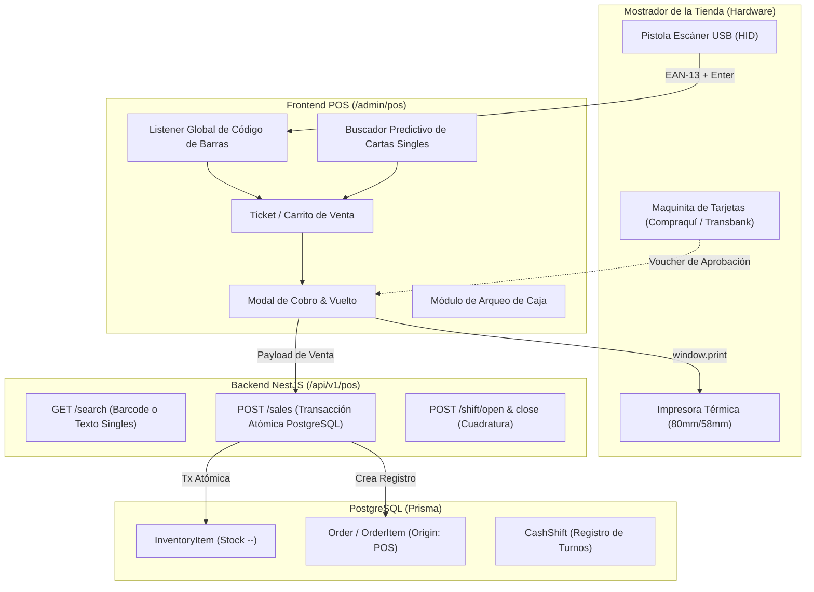

# 📋 Plan de Implementación: Módulo de Punto de Venta (POS)

Este plan detalla la arquitectura, el diseño de datos y los pasos de desarrollo para dotar a las tiendas de **TapTrade** de un sistema de **Punto de Venta (POS) presencial rápido y seguro**, optimizado para el flujo de tiendas físicas TCG (productos sellados con código de barras y cartas sueltas seleccionadas por estado).

---

## 🎯 Objetivos Clave del Módulo

1. **Sincronización Omnicanal en Tiempo Real:** Toda venta presencial descuenta el inventario de `InventoryItem` de forma atómica en milisegundos, evitando ventas dobles en la tienda web.
2. **Escaneo Automático de Genéricos:** Soporte nativo para pistolas lectoras de código de barras USB/Bluetooth (EAN-13 / UPC) para sobres, cajas selladas, micas/sleeves, carpetas y dados.
3. **Buscador Rápido de Cartas Sueltas (Singles):** Búsqueda predictiva con atajos de teclado para seleccionar edición, condición (NM, LP, etc.), idioma y stock disponible.
4. **Cobro Flexible y Realista (Chile):**
   - **Efectivo:** Con calculadora automática de vuelto y botones de billetes rápidos.
   - **Maquinita (CuentaRUT / Débito / Crédito):** Compatible con cualquier terminal física (Compraquí, Transbank, SumUp, MP Point) registrando el pago y Nº de comprobante/voucher.
   - **Transferencia Bancaria:** Confirmación de abono en cuenta de la tienda.
   - **Crédito de Tienda (*Store Credit*):** Integración nativa con el saldo a favor de jugadores en TapTrade.
5. **Control de Caja (Turnos y Arqueo):** Apertura de turno con fondo inicial y cierre de caja con cuadratura entre lo esperado por sistema y lo contado físicamente.
6. **Impresión de Tickets Térmicos:** Formato de comprobante optimizado para impresoras térmicas de 80mm y 58mm vía `@media print`.

---

## 🏗️ Arquitectura General del Flujo



---

## 🗄️ Fase 1: Modelo de Datos & Base de Datos (Prisma)

### 1.1. Modificaciones en [schema.prisma](file:///c:/Users/felix/Desktop/e-commerce/tienda-backend/prisma/schema.prisma)

1. **Campo `barcode` en `Product`:**
   ```prisma
   model Product {
     // ... campos existentes
     barcode      String?   // Código de barras EAN-13 / UPC
     sku          String?   // Código interno de la tienda

     @@index([barcode])
   }
   ```

2. **Nuevos Enums y Campos en `Order`:**
   ```prisma
   enum OrderOrigin {
     ONLINE_MARKETPLACE
     POS_IN_STORE
   }

   enum PosPaymentMethod {
     CASH
     CARD_POS       // Compraquí, Transbank, SumUp, MP Point
     TRANSFER
     STORE_CREDIT
     MIXED
   }

   model Order {
     // ... campos existentes
     origin           OrderOrigin       @default(ONLINE_MARKETPLACE)
     posPaymentMethod PosPaymentMethod?
     posVoucherRef    String?           // Nº de autorización o voucher de maquinita
     posCashierName   String?           // Nombre del cajero que atendió
     cashShiftId      String?
     cashShift        CashShift?        @relation(fields: [cashShiftId], references: [id])
   }
   ```

3. **Nuevo Modelo `CashShift` (Turnos y Cuadratura de Caja):**
   ```prisma
   model CashShift {
     id              String      @id @default(uuid())
     storeId         String
     cashierName     String
     status          String      @default("OPEN") // "OPEN" | "CLOSED"
     openedAt        DateTime    @default(now())
     closedAt        DateTime?
     initialCash     Decimal     @db.Decimal(10, 2) // Fondo inicial para dar vuelto
     expectedCash    Decimal?    @db.Decimal(10, 2) // Calculado por el sistema
     actualCash      Decimal?    @db.Decimal(10, 2) // Dinero físico contado por cajero
     cardTotal       Decimal     @default(0) @db.Decimal(10, 2)
     transferTotal   Decimal     @default(0) @db.Decimal(10, 2)
     creditTotal     Decimal     @default(0) @db.Decimal(10, 2)
     difference      Decimal?    @db.Decimal(10, 2) // Descuadre
     notes           String?
     createdAt       DateTime    @default(now())
     updatedAt       DateTime    @updatedAt

     store           Store       @relation(fields: [storeId], references: [id])
     orders          Order[]

     @@index([storeId, status])
   }
   ```

> [!IMPORTANT]
> Siguiendo las directivas de seguridad en BD, esta migración es **100% aditiva y no destructiva**. Se generará mediante migración limpia sin riesgo de pérdida de datos.

---

## ⚙️ Fase 2: Módulo Backend (NestJS / CQRS)

Creación de la carpeta `tienda-backend/src/pos/`:

### 2.1. Endpoints del Controlador (`pos.controller.ts`)

| Método | Endpoint | Descripción | Guardias |
| :--- | :--- | :--- | :--- |
| `GET` | `/api/v1/pos/search?q=...` | Búsqueda por `barcode` exacto o búsqueda predictiva de cartas singles filtradas por la tienda con stock > 0. | `JwtAuthGuard`, `StoreAdminGuard` |
| `POST` | `/api/v1/pos/sales` | Procesa y registra la venta presencial en una transacción atómica. | `JwtAuthGuard`, `StoreAdminGuard` |
| `GET` | `/api/v1/pos/shift/current` | Retorna el turno de caja abierto actual o null si la caja está cerrada. | `JwtAuthGuard`, `StoreAdminGuard` |
| `POST` | `/api/v1/pos/shift/open` | Abre el turno con el fondo de cambio inicial. | `JwtAuthGuard`, `StoreAdminGuard` |
| `POST` | `/api/v1/pos/shift/close` | Cierra la caja, calculando el arqueo de ventas por cada método de pago. | `JwtAuthGuard`, `StoreAdminGuard` |

### 2.2. Lógica de Transacción Atómica (`pos.service.ts`)
```typescript
// Pseudocódigo del núcleo de venta
async processSale(storeId: string, dto: CreatePosSaleDto) {
  return await this.prisma.$transaction(async (tx) => {
    // 1. Validar y decrementar stock de cada ítem
    for (const item of dto.items) {
      const invItem = await tx.inventoryItem.findFirst({
        where: { id: item.inventoryItemId, storeId },
      });
      if (!invItem || invItem.stock < item.quantity) {
        throw new BadRequestException(`Stock insuficiente para el producto`);
      }
      await tx.inventoryItem.update({
        where: { id: item.inventoryItemId },
        data: { stock: { decrement: item.quantity } },
      });
    }

    // 2. Si el pago usó Store Credit, descontar saldo del usuario
    if (dto.storeCreditAmount > 0) {
      // Descuento vía StoreCreditService existente
    }

    // 3. Crear registro de Orden POS completada
    const order = await tx.order.create({
      data: {
        buyOrder: `POS-${Date.now()}`,
        origin: 'POS_IN_STORE',
        status: 'PAID',
        totalAmount: dto.totalAmount,
        posPaymentMethod: dto.paymentMethod,
        posVoucherRef: dto.voucherRef,
        posCashierName: dto.cashierName,
        cashShiftId: dto.currentShiftId,
        // ... creación de VendorOrder y OrderItem
      },
    });

    return order;
  });
}
```

---

## 💻 Fase 3: Frontend del Punto de Venta (Next.js)

### 3.1. Navegación y Acceso desde el Panel de Tienda
- **Hub de Administración:** Se añade la cuarta tarjeta principal en [AdminHub](file:///c:/Users/felix/Desktop/e-commerce/tienda-front/src/app/admin/page.tsx):
  - **Título:** *"Punto de Venta (POS)"*
  - **Subtítulo:** *"Caja registradora para tu local físico, escáner de códigos y buscador de singles."*
  - **Tag:** *"Ventas en Mostrador"*
- **Sidebar:** Agregar botón directo en [Sidebar.tsx](file:///c:/Users/felix/Desktop/e-commerce/tienda-front/src/app/admin/_components/Sidebar.tsx).
- **Icono Centralizado:** Incorporar el icono `pos` en [Icons.tsx](file:///c:/Users/felix/Desktop/e-commerce/tienda-front/src/components/ui/Icons.tsx) cumpliendo estrictamente con la regla de no usar emojis ni SVGs en línea.

### 3.2. Estructura de Componentes (`tienda-front/src/app/admin/pos/`)

```
tienda-front/src/app/admin/pos/
├── page.tsx                     // Vista principal del POS (Layout de 2 columnas)
├── _components/
│   ├── PosHeader.tsx            // Barra superior con estado de caja, cajero y atajos
│   ├── PosBarcodeListener.tsx   // Hook invisible para captura global de escáner USB
│   ├── PosSearchBar.tsx         // Input universal: código de barras o texto de cartas
│   ├── PosSinglesResults.tsx    // Resultados de singles con variantes (NM, LP, etc.)
│   ├── PosCart.tsx              // Lista de productos del ticket actual y totales
│   ├── PosCheckoutModal.tsx     // Modal de cobro (Efectivo, Tarjeta, Transferencia, Crédito)
│   ├── PosShiftModal.tsx        // Modal de apertura y cierre con arqueo de caja
│   └── PosReceipt.tsx           // Plantilla oculta de ticket para impresora térmica
```

### 3.3. Experiencia de Usuario & Atajos de Teclado
- **F2:** Enfocar la barra de búsqueda de productos.
- **F10 / Barra Espaciadora:** Abrir modal de cobro directo.
- **Escape:** Cancelar búsqueda o cerrar modales.
- **Flechas Arriba/Abajo + Enter:** Navegar entre los resultados de cartas singles y agregar al carrito.

---

## 🖨️ Fase 4: Formato de Ticket Térmico (80mm y 58mm)

El ticket emitido al pulsar imprimir incluye:
- Nombre y RUT de la tienda.
- Dirección física del local.
- Fecha y hora exacta de la compra.
- Número de Ticket POS (ej: `#POS-00421`).
- Desglose de productos (ej: `2x Sobres Teracristal - $9.000`).
- Método de pago utilizado (Efectivo / Tarjeta / Transferencia / Crédito).
- Leyenda tributaria: *"Comprobante interno de venta. En pagos con tarjeta, su voucher de Transbank/Compraquí es su boleta oficial (Res. Ex. SII)"*.

---

## 🚀 Plan de Tareas Ejecutables

- [ ] **Tarea 1 (BD):** Agregar `barcode` a `Product`, enums de POS a `Order` y tabla `CashShift` en `schema.prisma`.
- [ ] **Tarea 2 (BD):** Generar migración segura de Prisma sin pérdida de datos.
- [ ] **Tarea 3 (Backend):** Crear módulo `pos` en NestJS con DTOs de validación y servicios de búsqueda y venta atómica.
- [ ] **Tarea 4 (Backend):** Implementar lógica de apertura, cálculo de totales y cierre de turno de caja (`CashShift`).
- [ ] **Tarea 5 (Frontend):** Registrar el icono en `Icons.tsx` y enlazar la ruta en `AdminHub` y `Sidebar`.
- [ ] **Tarea 6 (Frontend):** Construir la vista `/admin/pos` con captura de escáner de código de barras y buscador predictivo de cartas singles.
- [ ] **Tarea 7 (Frontend):** Desarrollar el modal de cobro multi-método con calculadora de vuelto para efectivo.
- [ ] **Tarea 8 (Frontend):** Implementar la plantilla de impresión de ticket térmico y el modal de arqueo de caja.
- [ ] **Tarea 9 (QA):** Validación cruzada: simular venta en POS y verificar que el stock disminuye al instante en la web pública.
